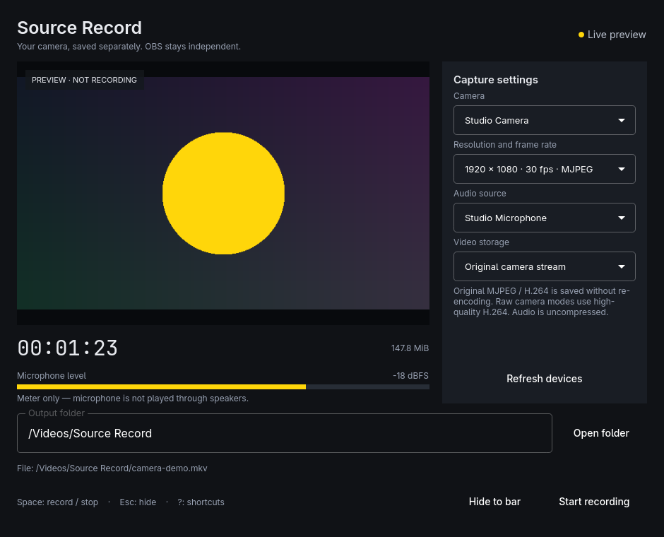

# Source Roll

Record your screen, camera, microphone, and desktop audio into separate files, ready to edit.

Source Roll is a recording app for Omarchy, built for people who put their videos together in post. Pick your sources, check the previews and audio levels, and start a take. You can crop the camera, rearrange the screen footage, and mix the audio later in your editor.



## What it does

- Records one screen or window, one camera, a microphone, and desktop audio. Enable only the sources you need.
- Saves screen video at its native resolution, with 30 or 60 fps and three quality presets.
- Keeps supported camera streams in their original format, or encodes them as H.264.
- Reconnects interrupted screen capture into separate segments while camera and audio continue, and warns when OmaControl is open during recording.
- Shows live screen and camera previews, audio meters, and recording controls in the app and Omarchy bar.
- Saves timing offsets and an OpenTimelineIO timeline to help align the files in an editor.
- Follows your Omarchy theme as it changes.

This is an early project. Multiple cameras, streaming, scene compositing, and headphone monitoring aren't supported yet.

## Install

Source Roll currently builds from source on Arch Linux with Omarchy. You'll need a C++ compiler, make, Qt 6 with qmake6, Python 3, FFmpeg, pactl, GPU Screen Recorder, PipeWire (`pw-dump`), and a working Wayland screen-sharing portal.

```sh
git clone https://github.com/TechHutTV/sourceroll.git
cd sourceroll
bin/install
```

The installer builds an Arch package, adds Source Roll to your app launcher, and installs the bar widget. It prompts for sudo when installing the package and restarts the Omarchy shell after updating the widget.

## Record a take

1. Open Source Roll from the app launcher.
2. Enable your sources and choose the camera and audio devices.
3. Enable Screen to pick a display or window. You can also click an empty screen preview to open the picker.
4. Check your framing and audio levels, then click Record or press Space.
5. Press Space again to stop. Wait for the files to finish saving before opening them in your editor.

New installs save to `~/Videos/Sourceroll`. You can change the folder in the app. Each take gets its own directory:

```text
take-YYYY-MM-DD_HH-mm-ss-mmm/
  screen.mkv
  camera.mkv
  microphone.wav
  desktop.wav
  session.json
  timeline.otio
```

Only the sources you enabled produce files. Audio is uncompressed PCM. The timeline uses measured start offsets; editor support for OpenTimelineIO varies. Camera and microphone processing can still add delay, so a clap at the start helps when you need precise sync.

Closing the window leaves an active recording running. Use the bar widget to monitor or stop it, or press Q in the app to quit and save.

| Shortcut | Action |
| --- | --- |
| Space | Start or stop recording |
| Esc | Hide to the bar |
| Q | Quit and save |
| ? | Show shortcuts |

## More details

The [recording guide](docs/recording.md) covers quality settings, timing, recovery, command-line controls, and removal. The [widget guide](plugin/README.md) covers the Omarchy plugin.

Settings live in `~/.config/sourceroll/settings.json`. Upgrading from Multitake imports your settings and keeps your recording folder. Recordings stay on your machine; there's no account or telemetry.

## Development

The app uses C++ and Qt Quick. FFmpeg handles camera and audio capture; GPU Screen Recorder handles the screen. The Omarchy widget lives in `plugin/`.

```sh
bin/build
bin/test
bin/check-plugin
```

See the [verification notes](docs/verification.md) for test coverage and hardware checks. When reporting a bug, include your Omarchy version, capture devices, enabled sources, and the error shown in the app.

## License

[MIT](LICENSE).
